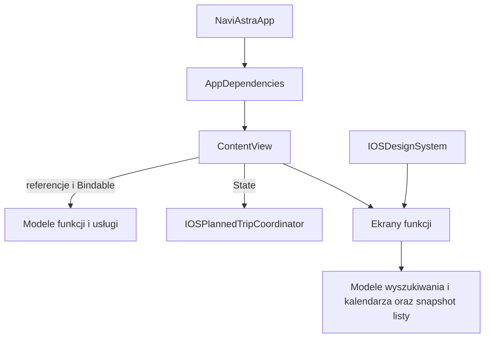

# Architektura i interfejs iOS — przegląd 30 października 2026

Zakres obejmuje aktywną aplikację iOS i widżet Live Activity. Punktem odniesienia były zainstalowane umiejętności `swiftui-patterns`, `axiom-swiftui` (architektura, układ, prezentacje i paski narzędzi) oraz `mobile-ios-design`. Reguły macOS nie są przenoszone na iPhone'a. Weryfikacja kompilacji korzysta z `build-run-debug` w zakresie pracy z Xcode dla istniejącego celu iOS.

## Ustalenia i wdrożone zmiany

| Obszar | Problem | Zmiana |
| --- | --- | --- |
| Własność danych | `ContentView` przechowywał w `@State` modele już należące do `AppDependencies`. | Wstrzyknięte modele są zwykłymi referencjami; `@Bindable` pozostaje tam, gdzie kontrolki potrzebują wiązań. `@State` służy lokalnemu stanowi prezentacji. |
| Prezentacja planów | Otwieranie edytora, oczekiwanie na zamknięcie biblioteki i powrót do planu zależały od czterech osobnych pól roota. | `IOSPlannedTripCoordinator` odpowiada za ten cykl, pozostawiając zapis i obliczenia w `TripPlanningService`. |
| Wspólny wygląd | Treść kart korzystała ze szkła i lokalnych wariantów nagłówków. | `IOSDesignSystem` definiuje systemowe powierzchnie kart, zwiększony kontrast, nagłówki sekcji, minimalny cel dotyku i szerokość czytelnej kolumny. Szkło pozostaje przy kontrolkach nad mapą. |
| Wyszukiwanie i miejsca | Ręczny nagłówek wyszukiwarki, powtarzane stany informacji i ciasne akcje ulubionych. | Natywny pasek iOS, `SearchFeedbackView`, wydzielony `SavedPlacesListView`, adaptacyjne akcje i większe pola dotyku. |
| Wybór trasy | Rozbudowana karta wariantu wewnątrz roota; transport oznaczony tylko ikonami. | `IOSRouteVariantCard` dostaje dane i akcje, składa się pionowo przy dużym tekście. `IOSRouteTransportSelector` pokazuje ikony i polskie podpisy, z dwoma kolumnami przy rozmiarach dostępności. |
| Plany podróży | Wyszukiwanie sieciowe i kalendarz w widokach; wielokrotne obliczanie najbliższych terminów. | Modele wyszukiwania i kalendarza, snapshot biblioteki z jednym czasem odniesienia, osobne karty/szczegóły i komponenty edytora. Grupowanie uwzględnia strefę zapisaną w planie. |
| Ustawienia | Duży katalog związany z rootem i brak wyszukiwania. | `IOSSettingsIndex` z typowanymi kategoriami, czterema sekcjami i wyszukiwaniem nazw oraz haseł. Dotychczasowe ustawienia i ich zapis pozostają w istniejących modelach. |
| Offline | Powtarzane wiersze zasobów, ciasne akcje i surowe komunikaty importu. | Osobne adaptacyjne wiersze map/paczek, polskie formatowanie rozmiarów i komunikaty; szczegóły techniczne trafiają do logów. |
| Historia i personalizacja | Konkurujące powierzchnie szkła, stale rozbudowane filtry i sztywne elementy. | Systemowe karty treści, zwijane filtry, typowany wybór widoku, skalowane wskaźniki i etykiety dostępności. |
| Paliwo, pogoda, komunikacja | Niespójne sekcje i poziome układy zależne od małego tekstu. | Wspólne karty/nagłówki, adaptacyjne metryki, przewijany panel pogody i osobny wiersz odjazdu z polskimi godzinami. |
| Live Activity | Stan GPS i sposób wyświetlania danych rozproszone między wariantami widżetu. | Wspólna prezentacja i mniejsze widoki; po utracie aktualności pozycji lub przy przeliczaniu nie pokazują starej instrukcji, schematu ani postępu jako bieżących danych. |

## Własność stanu

Modele danych mają jednego właściciela. Koordynator przechowuje stan prezentacji, a komponenty ekranu otrzymują dane i akcje. Dane trwałe nie są przenoszone do koordynatora ani do wspólnej warstwy wyglądu.

## Zasady dalszego rozwoju

- Nowy ekran otrzymuje jawne dane i akcje; nie staje się kolejną wielką sekcją `ContentView`.
- Obliczenia, pobieranie danych i anulowanie żądań należą do modeli funkcji. Widoki odpowiadają za prezentację i krótkie akcje użytkownika.
- `IOSCardSurface` służy treści. `NavigationGlassSurface` i panel mapy zachowują swoją rolę elementów nad mapą. Nie należy nakładać szkła na szkło wewnątrz zwykłej karty.
- Tekst korzysta ze stylów semantycznych, a układ z dostępnego miejsca i Dynamic Type. Zmiana układu nie powinna usuwać szkicu, wyboru ani fokusu.
- Wszystkie komunikaty i kontrolki korzystają z polskiego języka i `pl_PL`; plany zachowują zapisaną strefę czasową.
- Nie zmieniano algorytmów prowadzenia, formatów zapisu ani chronionego kodu macOS. Istniejące zmiany innych zadań w tym samym katalogu zostały zachowane.

## Weryfikacja i granice

Polecenia kompilacji, testów i archiwizacji uruchamiamy przez `python3 scripts/with-global-build-lock.py -- xcodebuild …`. Wrapper używa wspólnego `/tmp/codex-global-build.lock`, czeka również na wcześniej uruchomione kompilacje poza blokadą i zachowuje ją do zakończenia drivera oraz procesów kompilacji. Obsługuje bezpośrednie wywołania Xcode/Swift, bez skryptów daemonizujących. `resolve-ios-packages.sh` także korzysta z tej blokady.

Wstępny parser Swift dla nowych i zmienionych komponentów przeszedł; kontrola whitespace nie wykazała błędów. Zweryfikowano dostępność lokalizowanego `ByteCountFormatStyle` przez typecheck na zainstalowanym SDK. Porównanie chronionych plików, jawnych gałęzi `os(macOS)` i obiektów projektu `A200` z kopią sprzed pracy nie wykazało zmian.

Drugi przegląd poprawił inicjalizator sekcji SwiftUI z nagłówkiem i stopką, stabilność nawigacji po filtrowaniu ustawień, obszar wyszukiwania przystanków w szkicu bez startu oraz szerokość kategorii przy największym tekście. Komunikaty offline i miejsc w pobliżu mają polskie opisy, a techniczne szczegóły błędów trafiają do prywatnych logów. Próba sprawdzenia typów całej aplikacji z wcześniejszymi modułami zakończyła się brakiem modułu `ValhallaObjc`; nie jest to pozytywny wynik weryfikacji aplikacji. Pełna kompilacja została skierowana do globalnej kolejki.

Nie dodawano jednostkowych testów prostych elementów UI. Wynik pełnej kompilacji i weryfikacji uruchomienia jest uzupełniany po zakończeniu pracy. Ocena kodu obejmuje tryb jasny/ciemny, duży tekst i ograniczenie ruchu, ale nie zastępuje pełnego audytu VoiceOver ani wszystkich rozmiarów okien iPadOS.

`ContentView` nadal integruje mapę i część istniejących przepływów. Ten przegląd zmniejsza zależności i wydziela konkretne odpowiedzialności; nie stanowi migracji całej logiki nawigacji do nowego frameworka architektonicznego.

Źródła wzorców Apple: [zarządzanie modelami w SwiftUI](https://developer.apple.com/documentation/SwiftUI/Managing-model-data-in-your-app), [ViewThatFits](https://developer.apple.com/documentation/swiftui/viewthatfits), [Dynamic Type](https://developer.apple.com/documentation/swiftui/environmentvalues/dynamictypesize).
