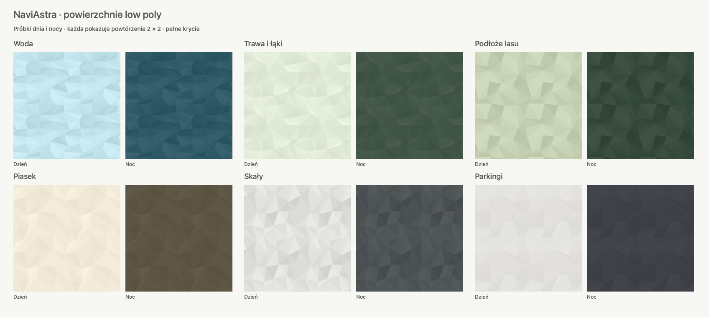

# Powierzchnie low poly na mapie iOS

Od iOS **1.1.162 (164)** woda, trawa, podłoże lasów, piasek, skały i parkingi
korzystają ze spójnych wzorów z płaskich wielokątów. Zastępują wcześniejsze
rastry TextureCan i Poly Haven, których refleksy, źdźbła, liście oraz ziarno
pozostawały zbyt szczegółowe po przeskalowaniu do mapy.

Podgląd przedstawia same wzory w powtórzeniu 2 × 2, przy pełnej intensywności.
Nie jest zrzutem ekranu MapLibre. Na mapie wzory mieszają się z kolorem podłoża
zależnie od powiększenia i trybu nawigacji.

## Wygląd i wydajność

`MapTerrainPattern` rysuje nieregularną, okresową siatkę trójkątów bez
ziarnistości, konturów i wbudowanych cieni. Woda ma szersze płaszczyzny,
trawa i las spokojne zielone odcienie, piasek i skały własne palety,
a parkingi najmniejszy kontrast. Geometria i kolory powtarzają się na obu
krawędziach kafla. Wyłączone wygładzanie pojedynczych trójkątów zapobiega
jasnym szczelinom pomiędzy nimi.

`MapTerrainTextureStyle` buforuje dwanaście obrazów 256 × 256 px z jawną
skalą 1: sześć materiałów w wariantach dnia i nocy. Noc zmniejsza amplitudę
różnic tonalnych o połowę. Obrazy powstają tylko raz na wariant i są ponownie
wykorzystywane po przeładowaniu stylu. Bufor RGBA zajmuje około 3 MiB,
bez atlasu MapLibre. Usunięto sześć nieużywanych JPG 1K (około 3,43 MiB)
i ich nieaktualny manifest; aplikacja nie pobiera tekstur z internetu.

| Obszar | Początek płynnego pojawiania się | Maksymalne krycie przy przeglądaniu |
| --- | --- | --- |
| Woda | z12 | 68% przy z19 |
| Trawa i łąki | z15 | 64% przy z19 |
| Podłoże lasów | z15 | 60% przy z17 |
| Piasek i skały | z14 | 60% przy z16 |
| Parkingi | z17 | 26% przy z19 |

Podczas nawigacji krycie jest ograniczone do 55% wartości przeglądania.
Mokradła zachowują symbole roślinności wodnej, a lasy dotychczasowe korony
i modele drzew. Powierzchnie terenu znajdują się pod wodą i drogami,
a faktura parkingów pod oznaczeniami miejsc. Tryb satelitarny je ukrywa.

Kształty nadal pochodzą z OpenMapTiles. Przy skonfigurowanym MapTiler Planet
trawa, las i parkingi wykorzystują jego poligony; woda, piasek i skały
pozostają w OpenMapTiles. Nie dodajemy geometrii ani obiektów w miejscach
bez danych źródłowych. Wzory nie opisują rzeczywistego gatunku roślin,
wysokości terenu, wielkości fal ani materiału konkretnego parkingu.

## Przegląd źródeł z 30 października 2026

| Źródło | Licencja według strony źródłowej | Ocena |
| --- | --- | --- |
| [Kenney Nature Kit](https://kenney.nl/assets/nature-kit) | CC0 | Kierunek wizualny: płaskie kolory i proste bryły, spójne z modelami już używanymi w mapie. Pakiet zawiera modele 3D, nie komplet sześciu rastrów terenu. |
| [Quaternius Ultimate Stylized Nature](https://quaternius.com/packs/ultimatestylizednature.html) | CC0 | Zestaw natury z teksturami; alternatywa dla modeli, bez potrzeby wymiany obecnego katalogu. |
| [QuickMesh Free Textures](https://quickmesh.dev/textures/) | Strona tekstur deklaruje zastosowania komercyjne i osobiste bez ograniczeń; nie deklaruje CC0. | Obejrzane pliki zawierają refleksy basenowe, szczegółowe liście, żwir i głazy. Nie przyjęto ich do aplikacji. |
| [OpenGameArt — Seamless Cartoon Textures](https://opengameart.org/content/seamless-cartoon-textures) | CC0, OzMaister | Duże kwiaty i źdźbła nadal tworzą zbyt wyrazisty deseń. |
| [OpenGameArt — Hand painted water texture (2K)](https://opengameart.org/content/hand-painted-water-texture-2k) | CC0, PamNawi | Kontrastowe pętle refleksów nie pasują do spokojnej wody low poly. |

Nowe wzory powstają w kodzie NaviAstra. Nie są kopiami ani przeróbkami
pobranych obrazów z powyższych zestawów. Licencje istniejących modeli Kenney
pozostają w `NaviAstra/Resources/Vendor/EnvironmentModels/`.

Podgląd można odtworzyć poleceniem `bash scripts/terrain-textures/preview.sh`.
Skrypt używa tego samego renderera CoreGraphics co iOS oraz wspólnej blokady
kompilacji. Jest narzędziem dokumentacji; nie buduje aplikacji macOS.
